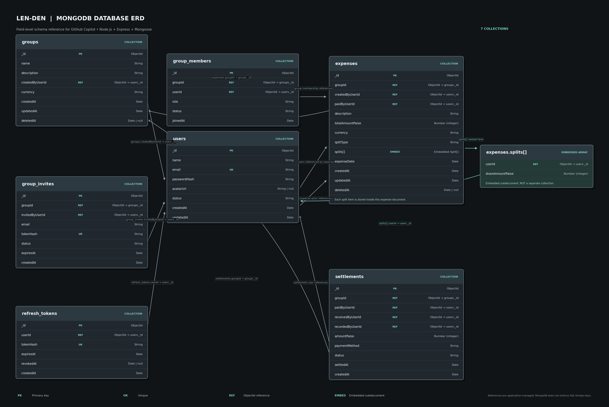

# Len-Den — Expense Sharing Application

Len-Den is a group expense-sharing app in development. It is designed to help people record shared expenses, see who owes what, and keep track of repayments.

## Project status

The project is currently at the setup and database-design stage. The MongoDB data model is shown below; the application features and API are not implemented yet.

## Technology

- **Node.js** and **Express** — planned backend runtime and REST API
- **MongoDB** — application database
- **Mongoose** — MongoDB schemas and data access

> This project uses MongoDB, not PostgreSQL. MongoDB stores data as documents in collections.

## MongoDB database diagram



[Open the SVG version](./len-den-mongodb-erd-copilot.svg) for a scalable diagram.

The diagram shows seven collections:

- **`users`** — user profiles and account details
- **`groups`** — group name, currency, and creator
- **`group_members`** — users who belong to each group, including their role
- **`expenses`** — expense details, payer, group, and amount
- **`settlements`** — repayments between group members
- **`group_invites`** — invitations to join a group
- **`refresh_tokens`** — refresh-token records for login sessions

Expense splits are embedded in an expense document as `splits[]`, rather than stored in a separate collection. MongoDB documents use `_id` values, and references between collections are managed by the application; MongoDB does not enforce relational foreign keys. Store money as integer paise (for example, ₹100.00 is `10000` paise) to avoid rounding errors.

## Getting started

You will need Node.js, npm, and access to a MongoDB database (local or hosted).

1. Install the project dependencies:

   ```bash
   npm install
   ```

2. Create a local environment file by copying `.env.example` to `.env`.
3. Set `MONGODB_URI` in `.env`. For a local MongoDB instance, the example value is:

   ```text
   mongodb://127.0.0.1:27017/len_den
   ```

4. The development command is `npm run dev`. The server and API still need to be implemented before this command can serve requests.

### Environment variables

| Variable | Purpose | Default |
| --- | --- | --- |
| `NODE_ENV` | Application environment | `development` |
| `PORT` | Port for the API server | `5000` |
| `MONGODB_URI` | MongoDB connection string | `mongodb://127.0.0.1:27017/len_den` |

Keep database credentials in `.env` or your hosting provider's secret settings. Do not commit credentials.

## Available scripts

| Command | Purpose |
| --- | --- |
| `npm run dev` | Run the development command with Nodemon |
| `npm start` | Run the server |
| `npm test` | Run tests with Node.js's test runner |

## Planned features

1. User registration, login, and session management
2. Groups, members, and invitations
3. Shared expenses with participant splits
4. Group balances and settlement tracking
5. Tests and deployment
